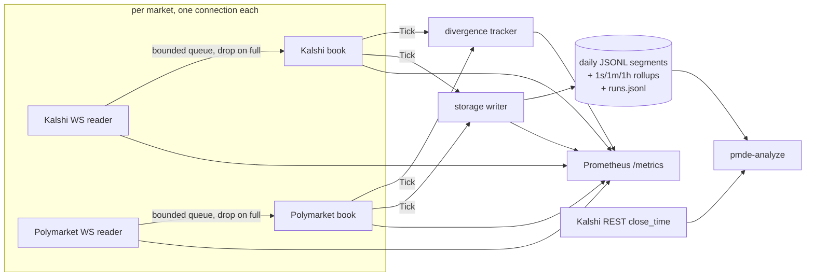

# PMDE

PMDE is a Go service that records Kalshi and Polymarket order books in
real time over WebSocket and measures how far the two venues' prices
diverge on hand-matched pairs of markets that resolve on the same event.
The Polymarket side is Polymarket's international venue (polymarket.com).
It has been running on a DigitalOcean droplet since October 22 2026.

First finding: [Kalshi vs Polymarket on the October 2026 FOMC decision](docs/fomc-oct-2026.md).
Kalshi's FOMC markets close at 1:59 PM ET, a minute before the statement,
so cross-venue price discovery at the decision can't be measured there.
Before the close, the gaps were real but small and short-lived after fees.

## Architecture



Each book goroutine sends every top-of-book change, as a `Tick`, to the
divergence tracker and the storage writer. Those sends block when the
queue is full; only the websocket reader is allowed to drop. So a slow
writer backs up into the reader's queue and shows up as counted drops
and a stale book, never as a stalled socket.

## Design decisions

- The reader never blocks. On a full queue it drops the message, counts
  it, and marks the book stale until a fresh snapshot. A slow consumer
  can't stall the socket, and a book is never used with a missing delta.
- Resync means reconnecting. Both venues start every subscription with a
  full snapshot, so a new connection is the one recovery path, used for
  drops, sequence gaps, bad messages and lost connections alike.
- Prices are integer basis points (0–10000), and sizes are integer
  hundredths. Fees are computed with `math/big` and each venue's own
  rounding rule, so no float rounding reaches a price or a fee.
- There's no `Exchange` interface, just two concrete clients. The venues
  differ in auth, heartbeats, book shape (Kalshi has yes/no bid books,
  Polymarket has real bids and asks) and snapshot semantics. An
  abstraction would hide exactly what needs to be visible.
- There are three direct dependencies: `gorilla/websocket`,
  `prometheus/client_golang`, and `go.yaml.in/yaml/v3` for the pair
  config.
- Storage is append-only JSON Lines, one file per market per record kind
  per UTC day, with 1s/1m/1h rollups computed as ticks are written. It's
  row-oriented because the workload is one small record appended per
  change, flushed and fsynced every second. A crash leaves at most a
  torn last line, which is repaired when the file is reopened, and the
  files can be read with `jq`.
- Resolved Polymarket markets stop retrying. The client stops on the
  venue's "resolved" close, or when a book never arrives and Polymarket's
  Gamma API reports the market resolved. Before this, two resolved assets
  reconnected about 33,500 times each.
- `pmde-analyze` takes the Kalshi cutoff from the market's `close_time`
  in Kalshi's API, and falls back to `kalshi_last_trade` in the pair
  config when the call fails. The contract terms said 1:55 PM, but
  trading ran until 1:59.

## Testing

- Book and feed tests replay captured live sessions from each venue
  (`testdata/`). The Polymarket replay is cross-checked against the
  venue's own reported best bid/ask.
- The client tests run the real reader and book goroutines against a
  local websocket server: reconnect mid-stream, forced drops, a slow
  storage chain, and a resolved close.
- Book parsing, the pair config, fees and divergence have table-driven
  tests.
- CI runs `go vet` and `go test -race` on every push.

## Running it

```
go build ./cmd/pmde && go build ./cmd/pmde-analyze

# the service: every pair in pairs.yaml, both venues
KALSHI_KEY_PATH=/path/to/private_key.pem KALSHI_KEY_ID=<key id> \
  ./pmde -config pairs.yaml -data-dir data -metrics-addr :9100

# per-pair report: coverage, mid divergence, gaps before/after fees, lead/lag
./pmde-analyze -data-dir data -from 2026-11-01 -to 2026-11-09

# both books' quotes at given times (archived October pairs)
./pmde-analyze -config pairs-2026-10.yaml -data-dir data \
  -quotes-at 2026-10-28T13:59:59.999-04:00,2026-10-28T14:00:04.537-04:00
```

Polymarket's market channel needs no credentials, but Kalshi's needs an
API key. To deploy on a Linux host with Docker, see
[docs/reference.md](docs/reference.md#deploying).

## Status

PMDE is recording the two December 9 2026 FOMC pairs (hold and hike-25)
on the droplet. The current run started on November 10 at commit e03eeb4.
The October pairs are archived in `pairs-2026-10.yaml`.

Live dashboard: https://maroonlimpet2967.grafana.net/public-dashboards/bbc5bbc97e4749908921f031ba0af07b

The full design notes, metrics, storage format and deploy steps are in
[docs/reference.md](docs/reference.md). The build history is in the
[commit log](https://github.com/lucasjohn05/PMDE/commits/main).
